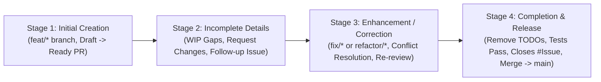

# Git & GitHub Collaborative Training Scenario — Sports Department

This training playbook turns the **Butuan City Sports Department (`sports-department`)** repository into a realistic, sprint-based engineering simulation for **4 personnel** collaborating across **12 website sections**.

> [!IMPORTANT]
> **Built-in Repository Guardrails Already Active**
> Participants will experience real production gates enforced by this repo:
> - **Branch baseline:** Work branches off [`development`](/src/app/routes/home/HomePage.tsx) and merges back via Pull Request; `main` is reserved for releases.
> - **Commit message hook ([commit-msg](/.husky/commit-msg)):** Enforces Conventional Commits (`feat|fix|style|refactor|chore|docs|test(scope): subject`).
> - **Pre-commit hook ([pre-commit](/.husky/pre-commit)):** Runs `npm run lint` before every commit.
> - **GitHub Actions CI ([ci.yml](/.github/workflows/ci.yml)):** Runs `lint`, `type-check`, `test`, `build`, and `check:bundle` (≤ 200 KB gzipped) on every PR to `development`, `staging`, or `main`.

---

## 1. Team Distribution (4 Personnel × 3 Sections)

The 12 sections are evenly distributed (**3 sections per person**) in logical domain groups so each participant owns an end-to-end slice while still intersecting on shared files to practice real collaboration and merge conflict resolution.

| Personnel | Role Focus | Assigned Sections | Primary Repo Files | Primary Reviewer |
| :--- | :--- | :--- | :--- | :--- |
| **Personnel 1 (Dev A)** | Shell, Entry & Identity | **1. Navigation Link**<br>**2. Home**<br>**3. About** | [navigation.ts](/src/config/navigation.ts), [SiteHeader.tsx](/src/components/layout/AppShell/SiteHeader.tsx), [DesktopNav.tsx](/src/components/layout/AppShell/DesktopNav.tsx), [MobileNav.tsx](/src/components/layout/AppShell/MobileNav.tsx), [HeroSection.tsx](/src/features/hero/components/organisms/HeroSection.tsx), [siteStats.ts](/src/features/hero/data/siteStats.ts), [AboutSection.tsx](/src/features/about/components/organisms/AboutSection.tsx), [about.ts](/src/features/about/data/about.ts) | **Personnel 2 (Dev B)** |
| **Personnel 2 (Dev B)** | Core Operations | **4. Programs**<br>**5. Events**<br>**6. Facilities** | [ProgramsSection.tsx](/src/features/programs/components/organisms/ProgramsSection.tsx), [programs.ts](/src/features/programs/data/programs.ts), [EventsSection.tsx](/src/features/events/components/organisms/EventsSection.tsx), [events.ts](/src/features/events/data/events.ts), [FacilitiesSection.tsx](/src/features/facilities/components/organisms/FacilitiesSection.tsx), [facilities.ts](/src/features/facilities/data/facilities.ts) | **Personnel 3 (Dev C)** |
| **Personnel 3 (Dev C)** | Community & Media | **7. Athletes**<br>**8. News**<br>**9. Gallery** | [AthletesSection.tsx](/src/features/athletes/components/organisms/AthletesSection.tsx), [athletes.ts](/src/features/athletes/data/athletes.ts), [NewsSection.tsx](/src/features/news/components/organisms/NewsSection.tsx), [news.ts](/src/features/news/data/news.ts), [GallerySection.tsx](/src/features/gallery/components/organisms/GallerySection.tsx), [gallery.ts](/src/features/gallery/data/gallery.ts) | **Personnel 4 (Dev D)** |
| **Personnel 4 (Dev D)** | Citizen Services & Chrome | **10. Resources**<br>**11. Contact**<br>**12. Footer** | [ResourcesSection.tsx](/src/features/resources/components/organisms/ResourcesSection.tsx), [resources.ts](/src/features/resources/data/resources.ts), [ContactSection.tsx](/src/features/contact/components/organisms/ContactSection.tsx), [inquirySchema.ts](/src/features/contact/constants/inquirySchema.ts), [SiteFooter.tsx](/src/components/layout/AppShell/SiteFooter.tsx), [site.ts](/src/config/site.ts) | **Personnel 1 (Dev A)** |

> [!TIP]
> **Cross-Team Shared Files (Intentional Collaboration Points)**
> - [site.ts](/src/config/site.ts) is touched by **Dev A** (Header/Brand info) and **Dev D** (Contact info & Footer links).
> - [HomePage.tsx](/src/app/routes/home/HomePage.tsx) and [navigation.ts](/src/config/navigation.ts) coordinate all 4 developers' sections.
> - Rotate reviewers each sprint (`A→B→C→D→A` in Sprint 1, `A→C`, `B→D` in Sprint 2, etc.) so every person reviews unfamiliar domains.

---

## 2. The 4-Stage Real-World Lifecycle

Every single section moves through **4 progressive stages** across 4 training sprints, mirroring how software actually evolves in production teams.



### What Each Stage Teaches

| Stage | Real-World Simulation | Git & GitHub Skills Practiced |
| :--- | :--- | :--- |
| **Stage 1: Initial Creation** | Dev picks up an assigned GitHub Issue and delivers the initial structure/baseline for the section. | `git checkout -b feat/<section>-init` from `development`, atomic Conventional Commits, opening a **Draft PR**, marking **Ready for Review**, linking Issues (`Refs #ID`), passing CI. |
| **Stage 2: Incomplete Details** | Dev submits a partial implementation with intentionally missing/placeholder details (missing fields, unverified stats, incomplete lists, or missing edge-case UI). Reviewer catches the gaps. | **Code Review** (`Request Changes`, inline comments, **GitHub Suggested Changes**), pushing follow-up commits to an open PR, or merging an agreed MVP while filing a tracked follow-up GitHub Issue (`stage:2-incomplete`). |
| **Stage 3: Enhancement or Correction** | Stakeholders/QA report typos, wrong data, UI/UX tweaks, or outdated demo entries (plus concurrent edits on shared files). | Creating `fix/<section>-*` / `refactor/<section>-*` branches, syncing with `git fetch origin && git rebase origin/development` (or merge), **resolving merge conflicts**, attaching before/after screenshots in PR descriptions, `git revert` drill. |
| **Stage 4: Completion of Section** | Final sign-off: replacing all `TODO`/`Sample` placeholders, updating unit tests (`vitest`), checking accessibility & bundle budget, closing all open issues. | Automated issue closing (`Closes #ID`), Squash & Merge, deleting merged branches, final **Release PR (`development` → `main`)** with GitHub Release notes & tag `v1.0.0`. |

---

## 3. Git & GitHub Standards for Participants

### Branch Naming Convention
Format: `<type>/<section>-<short-description>` (all lowercase, kebab-case)
- `feat/nav-initial-links`
- `feat/programs-partial-catalog`
- `fix/programs-remove-demo-entry`
- `refactor/events-status-badge`
- `chore/footer-final-gov-links`

### Required Labels & Milestones (Create in GitHub Repo)
- **Milestones:** `Sprint 1: Initial Creation`, `Sprint 2: Review & Gaps`, `Sprint 3: Corrections & Enhancements`, `Sprint 4: Section Completion & Release`
- **Labels:** `stage:1-initial`, `stage:2-incomplete`, `stage:3-enhancement`, `stage:4-complete`, `bug`, `enhancement`, `needs-review`, `changes-requested`, `good-pr-example`

### Standard PR Description Template
Every participant must fill this out on every PR (reviewers must reject blank PR descriptions):

```markdown
## Summary
<!-- Briefly explain WHAT changed and WHY -->

## Related Issue
- Refs #<issue-number> (use `Closes #<issue-number>` on Stage 4 completion)

## Stage
- [ ] Stage 1: Initial Creation
- [ ] Stage 2: Incomplete Details (WIP / Partial)
- [ ] Stage 3: Enhancement / Correction
- [ ] Stage 4: Section Completion

## Changes Made
- Bullet list of concrete edits and affected files

## Known Limitations / Follow-ups (Required for Stage 2)
- List intentionally incomplete details and linked follow-up issue numbers

## Verification & Screenshots
- [ ] `npm run lint` passed
- [ ] `npm run type-check` passed
- [ ] `npm test` passed
- [ ] Verified visually in `npm run dev` (attach before/after screenshot for UI changes)
```

---

## 4. Detailed Section-by-Section Training Scenarios

Each developer executes all 4 stages for their 3 assigned sections.

---

### Personnel 1 (Dev A) — Navigation Link, Home, About

#### 1. Navigation Link
*Files:* [navigation.ts](/src/config/navigation.ts), [SiteHeader.tsx](/src/components/layout/AppShell/SiteHeader.tsx), [DesktopNav.tsx](/src/components/layout/AppShell/DesktopNav.tsx), [MobileNav.tsx](/src/components/layout/AppShell/MobileNav.tsx)
- **Stage 1 — Initial Creation (`feat/nav-initial-setup`):** Define core anchor entries in `NAV_ITEMS` (`home`, `about`, `programs`, `events`, `contact`) and verify header brand link points to `#home`. Open PR with Issue link.
- **Stage 2 — Incomplete Details (`feat/nav-expand-links`):** Add remaining nav items (`facilities`, `athletes`, `news`, `gallery`, `resources`) **but intentionally omit `resources` or leave a mismatched anchor ID** (e.g., `#facility` instead of `#facilities`) and leave the header logo as the placeholder `Trophy` icon. *Reviewer action:* Catch the broken scroll anchor in inline review and request changes / open a bug issue.
- **Stage 3 — Enhancement / Correction (`fix/nav-anchor-and-mobile-ux`):** Fix the mismatched anchor ID, add an active-link indicator/accessibility label polish in `DesktopNav`/`MobileNav`, and resolve a **merge conflict** on `SiteHeader.tsx` / `site.ts` after Dev D updates `SITE.name` or `SITE.shortName`.
- **Stage 4 — Completion (`feat/nav-complete`):** Verify all 10 section anchors match `HomePage.tsx` IDs, update [AppShell.test.tsx](/src/components/layout/AppShell/AppShell.test.tsx) to assert all nav links render, remove `TODO` comments, and close all nav issues.

#### 2. Home (Hero)
*Files:* [HeroSection.tsx](/src/features/hero/components/organisms/HeroSection.tsx), [siteStats.ts](/src/features/hero/data/siteStats.ts), [HeroCtaGroup.tsx](/src/features/hero/components/molecules/HeroCtaGroup.tsx)
- **Stage 1 — Initial Creation (`feat/home-hero-baseline`):** Establish initial Hero headline, department subtitle, primary CTA button, and initial `siteStatsFixture` baseline metrics.
- **Stage 2 — Incomplete Details (`feat/home-stats-draft`):** Update stats strip with draft numbers, **but leave `medals_year` outdated (e.g., `2024`) and leave secondary CTA href pointing to `#`** with a `TODO` note. *Reviewer action:* Leave a **GitHub Suggested Change** on `siteStats.ts` and flag the dead `#` CTA link.
- **Stage 3 — Enhancement / Correction (`fix/home-cta-and-stats`):** Apply reviewer suggestion, wire secondary CTA to `#programs` or `#events`, refine responsive hero spacing/copy, and ensure the single `<h1>` rule in [HomePage.test.tsx](/src/app/routes/home/HomePage.test.tsx) stays green.
- **Stage 4 — Completion (`feat/home-complete`):** Finalize approved department metrics (`athletes_count`, `programs_count`, `facilities_count`, `medals_count`, `medals_year`), verify [HeroSection.test.tsx](/src/features/hero/components/organisms/HeroSection.test.tsx) passes, and close Home issues.

#### 3. About
*Files:* [AboutSection.tsx](/src/features/about/components/organisms/AboutSection.tsx), [about.ts](/src/features/about/data/about.ts)
- **Stage 1 — Initial Creation (`feat/about-initial-content`):** Populate initial draft of Mandate, Mission, and Vision statements for Butuan City Sports Department.
- **Stage 2 — Incomplete Details (`feat/about-officials-wip`):** Add City Sports Officer message, **but leave `officials` entries as `"Official name pending"` and `"Position pending"`** with missing bio paragraphs. *Reviewer action:* Comment on missing official roles and file an enhancement issue to supply full leadership roster.
- **Stage 3 — Enhancement / Correction (`fix/about-leadership-corrections`):** Correct misspelled titles/names, refine officer message formatting, and enhance layout alignment for leadership cards.
- **Stage 4 — Completion (`feat/about-complete`):** Replace all `"Sample ..."` and `"pending"` strings in `aboutFixture`, verify accessible alt text/fallbacks for photos, and close About issues.

---

### Personnel 2 (Dev B) — Programs, Events, Facilities

#### 4. Programs
*Files:* [ProgramsSection.tsx](/src/features/programs/components/organisms/ProgramsSection.tsx), [programs.ts](/src/features/programs/data/programs.ts), [programCategories.ts](/src/features/programs/constants/programCategories.ts)
- **Stage 1 — Initial Creation (`feat/programs-initial-catalog`):** Set up the initial grassroots and youth sports program catalog entries with categories and icons.
- **Stage 2 — Incomplete Details (`feat/programs-add-schedules`):** Add new programs **with missing `coach_name`, `coach_contact`, and `"Venue pending"` placeholders** (and leave an accidental/demo entry such as the existing `Learn to Sabong` entry in `programs.ts`). *Reviewer action:* Flag the inappropriate/demo program entry and missing coach/venue fields using `Request Changes`.
- **Stage 3 — Enhancement / Correction (`fix/programs-cleanup-and-details`):** **Real-world cleanup / `git revert` or hotfix exercise:** Remove/replace the `Learn to Sabong` demo entry with an official sports program (e.g., *Learn to Swim* / *Grassroots Athletics*), fix typos in summary text, and add complete venue & schedule info.
- **Stage 4 — Completion (`feat/programs-complete`):** Ensure every program has full descriptions, requirements, age groups, coach details, and working "Inquire" prefill flow; verify [ProgramsSection.test.tsx](/src/features/programs/components/organisms/ProgramsSection.test.tsx) passes and close issues.

#### 5. Events
*Files:* [EventsSection.tsx](/src/features/events/components/organisms/EventsSection.tsx), [events.ts](/src/features/events/data/events.ts), [sports.ts](/src/features/events/constants/sports.ts)
- **Stage 1 — Initial Creation (`feat/events-initial-calendar`):** Add initial city tournament schedule items covering `upcoming`, `ongoing`, and `completed` statuses.
- **Stage 2 — Incomplete Details (`feat/events-draft-venues`):** Add 3–4 more events **but leave `venue: 'Venue pending'`, omit `is_featured` on the flagship event, and accidentally set an `end_date` earlier than `start_date`**. *Reviewer action:* Catch the invalid date range and missing featured flag in review.
- **Stage 3 — Enhancement / Correction (`fix/events-dates-and-filters`):** Fix the inverted date range, assign verified venues, link relevant `news_id` references (coordinating with Dev C's News IDs!), and verify `.ics` calendar export works cleanly.
- **Stage 4 — Completion (`feat/events-complete`):** Remove all `"Sample ..."` event names, verify [events.test.ts](/src/features/events/utils/events.test.ts) and [EventsSection.test.tsx](/src/features/events/components/organisms/EventsSection.test.tsx) pass, and close Events issues.

#### 6. Facilities
*Files:* [FacilitiesSection.tsx](/src/features/facilities/components/organisms/FacilitiesSection.tsx), [facilities.ts](/src/features/facilities/data/facilities.ts)
- **Stage 1 — Initial Creation (`feat/facilities-initial-directory`):** Add initial list of Butuan City sports complexes and covered courts in `facilitiesFixture`.
- **Stage 2 — Incomplete Details (`feat/facilities-hours-wip`):** Add additional barangay facilities **with `"Barangay pending"`, missing `status_note` for a closed/under-maintenance court (`is_open: false`), and incomplete amenities list**. *Reviewer action:* Request status explanation for closed facilities and real barangay names.
- **Stage 3 — Enhancement / Correction (`fix/facilities-status-and-coords`):** Add accurate barangay/addresses, update `status_note` (e.g., `"Under roof rehabilitation until Dec 2026"`), refine operating hours, and standardize amenity tags.
- **Stage 4 — Completion (`feat/facilities-complete`):** Confirm every facility has valid coordinates, amenities, open/closed status notes, and zero placeholder comments; verify build/tests and close issues.

---

### Personnel 3 (Dev C) — Athletes, News, Gallery

#### 7. Athletes
*Files:* [AthletesSection.tsx](/src/features/athletes/components/organisms/AthletesSection.tsx), [athletes.ts](/src/features/athletes/data/athletes.ts)
- **Stage 1 — Initial Creation (`feat/athletes-initial-profiles`):** Create initial featured athlete roster and medal tally table structure.
- **Stage 2 — Incomplete Details (`feat/athletes-tally-draft`):** Add competition rows to medal tally, **but leave athlete names as `Sample Athlete 1..4` and introduce an intentionally mismatched medal total / missing sport discipline**. *Reviewer action:* Flag placeholder athlete profiles and request tally verification.
- **Stage 3 — Enhancement / Correction (`fix/athletes-profiles-and-tally`):** Replace sample athlete names/achievements with realistic training profiles, fix medal tally numbers, and add a new sport category highlight.
- **Stage 4 — Completion (`feat/athletes-complete`):** Remove all placeholder markers in `athletes.ts`, confirm [AthletesSection.test.tsx](/src/features/athletes/components/organisms/AthletesSection.test.tsx) passes, and close Athletes issues.

#### 8. News
*Files:* [NewsSection.tsx](/src/features/news/components/organisms/NewsSection.tsx), [news.ts](/src/features/news/data/news.ts)
- **Stage 1 — Initial Creation (`feat/news-initial-articles`):** Author initial set of news items across `announcement`, `result`, `advisory`, and `feature` categories.
- **Stage 2 — Incomplete Details (`feat/news-draft-stories`):** Add paginated articles **with truncated `"Sample excerpt"` text, missing second body paragraphs, and an invalid/misformatted `published_at` date**. *Reviewer action:* Use inline comments to catch the malformed date and incomplete article excerpts.
- **Stage 3 — Enhancement / Correction (`fix/news-copy-and-sorting`):** Fix date formatting so newest-first sorting in `loadNewsFixture` works properly, expand article body paragraphs, and coordinate article IDs with Dev B's `Events` (`news_id`).
- **Stage 4 — Completion (`feat/news-complete`):** Verify pagination, category filtering, article modal reading experience, and passing [NewsSection.test.tsx](/src/features/news/components/organisms/NewsSection.test.tsx); close News issues.

#### 9. Gallery
*Files:* [GallerySection.tsx](/src/features/gallery/components/organisms/GallerySection.tsx), [gallery.ts](/src/features/gallery/data/gallery.ts)
- **Stage 1 — Initial Creation (`feat/gallery-initial-albums`):** Set up initial photo albums (e.g., *City Athletic Meet*, *Grassroots Clinics*) with cover items and captions.
- **Stage 2 — Incomplete Details (`feat/gallery-album-draft`):** Add a new album **with generic `"Sample photo N"` captions, empty alt text, or an album containing only 1 photo**. *Reviewer action:* Flag accessibility gap (missing descriptive captions/alt text) and request changes.
- **Stage 3 — Enhancement / Correction (`fix/gallery-captions-and-a11y`):** Add meaningful event captions, fix aspect-ratio/lightbox labeling, and verify keyboard navigation in the lightbox.
- **Stage 4 — Completion (`feat/gallery-complete`):** Clean up placeholder metadata, ensure [GallerySection.test.tsx](/src/features/gallery/components/organisms/GallerySection.test.tsx) passes and bundle size remains under budget (`npm run check:bundle`), and close Gallery issues.

---

### Personnel 4 (Dev D) — Resources, Contact, Footer

#### 10. Resources
*Files:* [ResourcesSection.tsx](/src/features/resources/components/organisms/ResourcesSection.tsx), [resources.ts](/src/features/resources/data/resources.ts), `public/files/`
- **Stage 1 — Initial Creation (`feat/resources-initial-forms-faqs`):** Populate initial downloadable forms list and starter FAQs in `downloadsFixture` and `faqsFixture`.
- **Stage 2 — Incomplete Details (`feat/resources-add-guides`):** Add 2 more downloadable forms **with broken file paths (files not yet placed in `public/files/`) and `size_kb: 0`**, plus incomplete FAQ answers (`"Sample answer..."`). *Reviewer action:* Catch broken download URLs and incomplete FAQ answers via `Request Changes`.
- **Stage 3 — Enhancement / Correction (`fix/resources-files-and-faqs`):** Add the actual sample files to `public/files/`, update exact file types/sizes/`updated_at`, and flesh out clear citizen-facing FAQ answers.
- **Stage 4 — Completion (`feat/resources-complete`):** Verify every download link resolves, confirm accordion FAQs work and [ResourcesSection.test.tsx](/src/features/resources/components/organisms/ResourcesSection.test.tsx) passes, and close Resources issues.

#### 11. Contact
*Files:* [ContactSection.tsx](/src/features/contact/components/organisms/ContactSection.tsx), [ContactDetails.tsx](/src/features/contact/components/molecules/ContactDetails.tsx), [InquiryForm.tsx](/src/features/contact/components/molecules/InquiryForm.tsx), [inquirySchema.ts](/src/features/contact/constants/inquirySchema.ts), [site.ts](/src/config/site.ts)
- **Stage 1 — Initial Creation (`feat/contact-initial-info`):** Populate initial department address and office hours in `site.ts` and verify the inquiry form renders.
- **Stage 2 — Incomplete Details (`feat/contact-details-draft`):** Leave `phone: ''`, `email: ''`, and `facebookUrl: ''` blank in `site.ts` and omit a helpful validation error message in `inquirySchema.ts`. *Reviewer action:* Flag empty contact fields (`TODO(T-23)`) and request explicit Zod error messages.
- **Stage 3 — Enhancement / Correction (`fix/contact-validation-and-info`):** Populate full office address, phone, official email, Facebook URL, and refined Zod validation messages; **practice merge conflict resolution** on `site.ts` with Dev A.
- **Stage 4 — Completion (`feat/contact-complete`):** Remove remaining `TODO(T-23)` markers for contact details, verify [InquiryForm.test.tsx](/src/features/contact/components/molecules/InquiryForm.test.tsx) and [inquirySchema.test.ts](/src/features/contact/constants/inquirySchema.test.ts) pass, and close Contact issues.

#### 12. Footer
*Files:* [SiteFooter.tsx](/src/components/layout/AppShell/SiteFooter.tsx), [site.ts](/src/config/site.ts)
- **Stage 1 — Initial Creation (`feat/footer-initial-links`):** Verify `GOV_LINKS` and base `CITY_LINKS` structure render cleanly in `SiteFooter.tsx`.
- **Stage 2 — Incomplete Details (`feat/footer-city-links-wip`):** Add Transparency Seal and Citizen's Charter entries to `CITY_LINKS` **but leave placeholder `href: '#'` links and omit FOI link**. *Reviewer action:* Flag dead external links and missing FOI compliance link.
- **Stage 3 — Enhancement / Correction (`fix/footer-compliance-links`):** Add proper URLs for Transparency Seal, Citizen's Charter, and FOI Portal, ensure `rel="noopener noreferrer"` / accessibility polish, and sync copyright/department details with `site.ts`.
- **Stage 4 — Completion (`feat/footer-complete`):** Remove `TODO(T-23)` in `CITY_LINKS`, verify [AppShell.test.tsx](/src/components/layout/AppShell/AppShell.test.tsx) passes, and close Footer issues.

---

## 5. Planned Real-World GitHub Drills (Injected Across Sprints)

To make the training genuinely mirror day-to-day engineering, inject these 5 realistic drills:

1. **Pre-commit & Commit-Msg Hook Rejection (Sprint 1):**
   Have each dev intentionally try `git commit -m "updated stuff"` once to observe `.husky/commit-msg` reject it, then commit properly with `feat(about): add initial department mandate`.
2. **Draft PR → Request Changes → Suggested Changes (Sprint 2):**
   Every reviewer must submit at least **1 inline comment**, **1 GitHub Suggested Change block**, and **1 `Request Changes`** review. Authors must commit the suggestion from the GitHub UI, pull locally (`git pull`), push an additional fix commit, and click **Re-request review**.
3. **Controlled Merge Conflict Resolution (Sprint 3):**
   - **Pair 1 (Dev A + Dev D):** Both branch from `development` at the same time and modify `SITE` in [site.ts](/src/config/site.ts). Dev A merges first; Dev D must pull/rebase `origin/development`, resolve the conflict locally without losing Dev A's changes, run `npm test`, and push.
   - **Pair 2 (Dev B + Dev C):** Both edit a shared section comment/order or metadata in [HomePage.tsx](/src/app/routes/home/HomePage.tsx) (or [navigation.ts](/src/config/navigation.ts)). Dev B merges first; Dev C resolves the conflict.
4. **CI Failure Triage (Sprint 3):**
   One dev pushes an unused variable or TypeScript type mismatch so [ci.yml](/.github/workflows/ci.yml) fails on the PR. Practice reading GitHub Actions logs, fixing locally, and confirming green checks before merge.
5. **Release PR & Tagging (End of Sprint 4):**
   Once all 12 sections are complete on `development`, designate a Release Captain to open a **Release PR (`development` → `main`)** with auto-generated release notes, get sign-off from all 4 personnel, merge, and create GitHub Release **`v1.0.0`**.

---

## 6. Facilitator Pre-Training Setup Checklist

Before kicking off the workshop on GitHub:
- [ ] **Branch Protection on `main` and `development`:**
  - Require Pull Request before merging (no direct pushes).
  - Require at least **1 approving review** (dismiss stale approvals on new pushes).
  - Require status checks to pass (`frontend` job from [ci.yml](/.github/workflows/ci.yml)).
  - Enable "Automatically delete head branches" after merge.
- [ ] **Create GitHub Labels & 4 Milestones** (Sprint 1–4) listed in Section 3.
- [ ] **Add a PR Template** at `.github/PULL_REQUEST_TEMPLATE.md` and Issue Templates at `.github/ISSUE_TEMPLATE/` so every participant gets structured forms automatically.
- [ ] **Decide Starting State of `development`:**
  - *Option A (Fastest — Content & Refinement Track):* Keep the current scaffolded components in `development` (which already have `PLACEHOLDER CONTENT` & `TODO(T-23)` markers) and have participants treat Stage 1 as replacing scaffold placeholders with initial real content/features.
  - *Option B (From-Scratch Component Track):* Create a training reset branch where the 12 sections start as stubs/placeholders using [SectionPlaceholder.tsx](/src/components/common/SectionPlaceholder.tsx) so Stage 1 truly builds each section from scratch.
